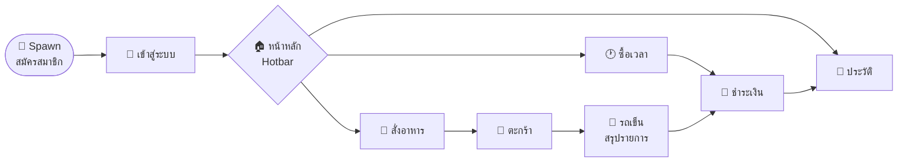
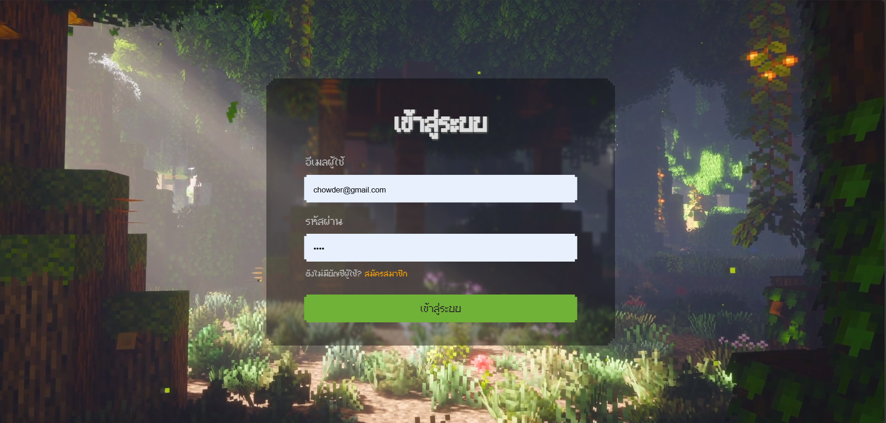
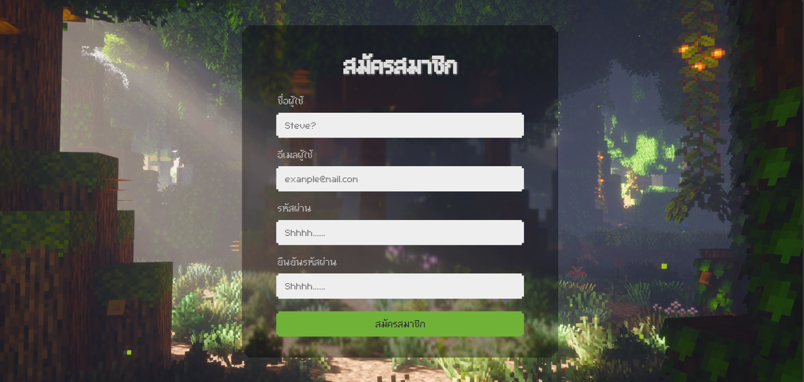
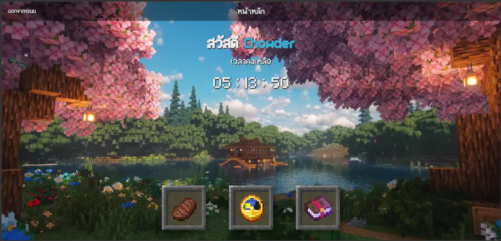
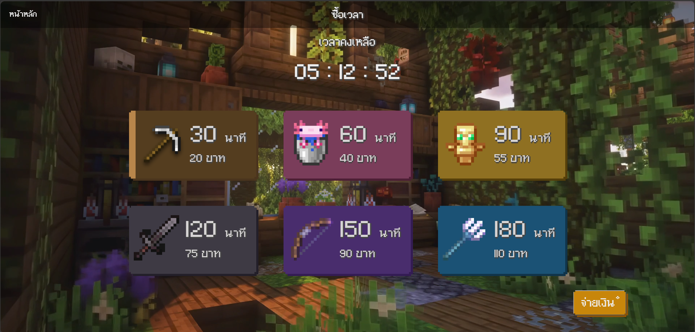
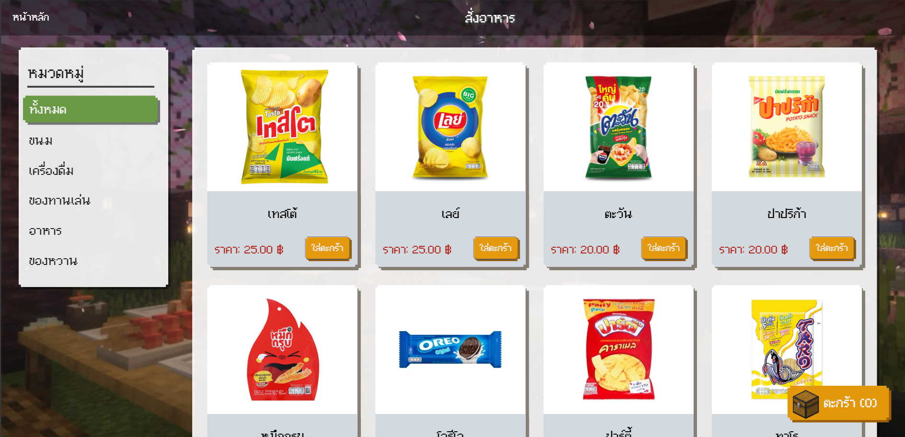
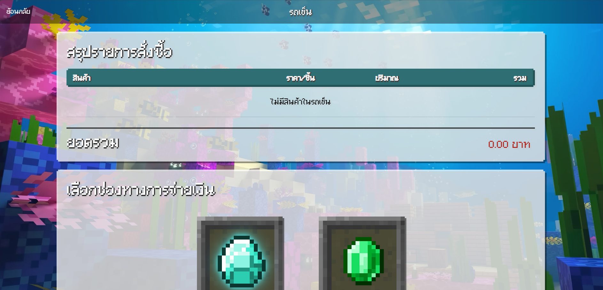
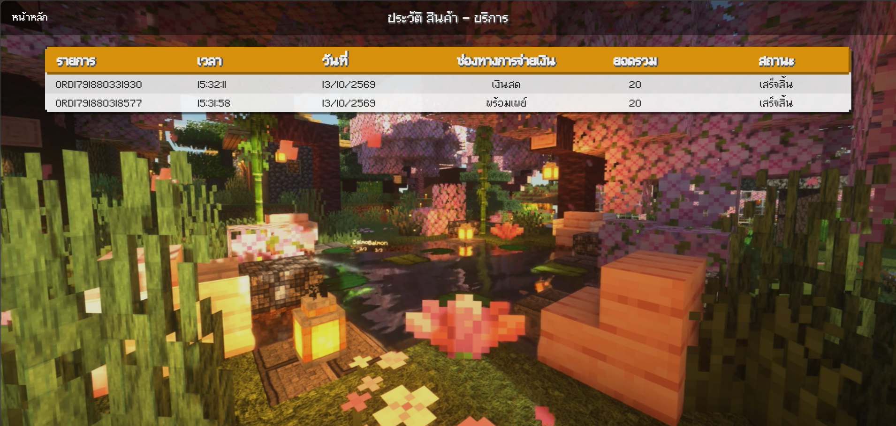
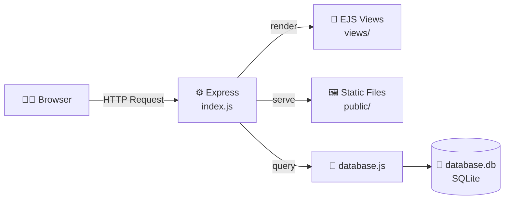

<div align="center">


<a href="https://github.com/Poseidonimous/webpro_group">
  
</a>

<br/>


### ⛏️ ระบบซื้อเวลา & สั่งอาหารออนไลน์ ในโลกสี่เหลี่ยมสไตล์ Minecraft 🧱

🟩🟩🟩🟩🟩🟩🟩🟩🟩🟩🟩🟩🟩🟩🟩🟩🟩🟩🟩🟩
🟫🟫🟫🟫🟫🟫🟫🟫🟫🟫🟫🟫🟫🟫🟫🟫🟫🟫🟫🟫

[🌍 เกี่ยวกับ](#about) •
[🏆 ฟีเจอร์](#features) •
[📸 ภาพตัวอย่าง](#screenshots) •
[💰 ราคา](#pricing) •
[🧱 Tech Stack](#tech) •
[🚀 ติดตั้ง](#install) •
[👥 ทีมงาน](#team)

</div>

```text
 ┌────────────────────────────────────────────────┐
 │  WEBPRO GROUP  -  Minecraft Edition            │
 │  Generating terrain...   [##########] 100%     │
 │  Spawn point set. Welcome to the server!       │
 └────────────────────────────────────────────────┘
```

<br/>

<a id="about"></a>
## 🌍 World Info — เกี่ยวกับโปรเจกต์

**WEBPRO GROUP** คือเว็บแอปพลิเคชันสำหรับร้านเกม / เน็ตคาเฟ่ ที่ให้ผู้เล่น **สมัครสมาชิก → ซื้อเวลาเล่น → สั่งขนมและเครื่องดื่ม → ชำระเงิน → ดูประวัติการใช้งาน** ได้ครบจบในที่เดียว
ทุกหน้าถูกออกแบบด้วยธีม **Minecraft** ตั้งแต่ปุ่มสีหญ้า ไอเท็มใน Hotbar ไปจนถึงฉากหลังแบบ shader สุดละมุน เหมือนกำลังเดินอยู่ในเซิร์ฟเวอร์จริง ๆ 🌸

| 🗂️ รายการ | 📋 รายละเอียด |
|:--|:--|
| 🏷️ ชื่อโปรเจกต์ | WEBPRO GROUP |
| 🎨 ธีม | Minecraft (pixel font, inventory slot, shader background) |
| 🌐 ภาษาหน้าเว็บ | ภาษาไทย 🇹🇭 |
| ⚙️ Backend | Node.js + Express 5 |
| 🖼️ View Engine | EJS |
| 💾 Database | SQLite |
| 🎓 ประเภทงาน | โปรเจกต์กลุ่ม วิชา Web Programming |

<br/>

<a id="features"></a>
## 🏆 Advancements — ฟีเจอร์ทั้งหมด

> ### 🏆 **Advancement Made!** — *ปลดล็อกครบทุกฟีเจอร์แล้ว*

| 🏅 Advancement | 🧩 ฟีเจอร์ | 📝 รายละเอียด |
|:--|:--|:--|
| 🌱 **Welcome to the Server** | สมัครสมาชิก & เข้าสู่ระบบ | สมัครด้วยชื่อผู้ใช้ อีเมล รหัสผ่าน และยืนยันรหัสผ่าน • เข้าสู่ระบบด้วยอีเมลกับรหัสผ่าน • จัดการสถานะล็อกอินด้วย session + cookie |
| 🏠 **Home Sweet Home** | หน้าหลัก | ทักทายผู้ใช้ด้วยชื่อ • แสดง **เวลาคงเหลือ** แบบนับถอยหลัง `HH : MM : SS` • เมนูหลักแบบ Hotbar 3 ช่อง • ปุ่มออกจากระบบ |
| ⏱️ **Time Is Money** | ซื้อเวลา | แพ็กเกจเวลา 6 ระดับ ตั้งแต่ 30 – 180 นาที พร้อมไอคอนเครื่องมือประจำแต่ละแพ็กเกจ |
| 🍞 **Hungry Steve** | สั่งอาหาร | เลือกสินค้าตามหมวดหมู่ (ทั้งหมด / ขนม / เครื่องดื่ม / ของทานเล่น / อาหาร / ของหวาน) • การ์ดสินค้าพร้อมรูปและราคา • ปุ่ม **ใส่ตะกร้า** |
| 🧰 **Chest Full of Loot** | ตะกร้า & รถเข็น | ปุ่มตะกร้าแบบ Chest แสดงจำนวนชิ้น • หน้าสรุปรายการสั่งซื้อ (สินค้า / ราคาต่อชิ้น / ปริมาณ / รวม) • ยอดรวมสุทธิ |
| 💎 **Diamonds or Emeralds?** | เลือกช่องทางชำระเงิน | เลือกวิธีจ่ายเงินด้วยไอคอนไดมอนด์และมรกต (ในประวัติพบ **เงินสด** และ **พร้อมเพย์**) |
| 📖 **Enchanted Library** | ประวัติสินค้า – บริการ | ตารางรายการ: เลขที่ออเดอร์ • เวลา • วันที่ (พ.ศ.) • ช่องทางชำระเงิน • ยอดรวม • สถานะ |

### 🎒 Hotbar — เมนูหลักบนหน้าแรก

| 🍞 Slot 1 | 🕐 Slot 2 | 📖 Slot 3 |
|:-:|:-:|:-:|
| **สั่งอาหาร** | **ซื้อเวลา** | **ประวัติ** |
| เลือกขนม เครื่องดื่ม อาหาร ใส่ตะกร้า | เติมเวลาเล่นตามแพ็กเกจ | ดูออเดอร์ย้อนหลังทั้งหมด |

### 🧭 Player Journey — เส้นทางการใช้งาน



<br/>

<a id="screenshots"></a>
## 📸 Screenshots — ภาพตัวอย่างหน้าเว็บ

<table>
  <tr>
    <td align="center" width="50%">
      <br/>
      <b>🔑 เข้าสู่ระบบ</b><br/><sub>ป่าลึกยามเช้า แสงลอดใบไม้</sub>
    </td>
    <td align="center" width="50%">
      <br/>
      <b>🌱 สมัครสมาชิก</b><br/><sub>สร้างตัวละครใหม่ในเซิร์ฟเวอร์</sub>
    </td>
  </tr>
  <tr>
    <td align="center" width="50%">
      <br/>
      <b>🏠 หน้าหลัก</b><br/><sub>เวลาคงเหลือ + Hotbar 3 ช่อง</sub>
    </td>
    <td align="center" width="50%">
      <br/>
      <b>⏱️ ซื้อเวลา</b><br/><sub>6 แพ็กเกจ พร้อมไอคอนเครื่องมือ</sub>
    </td>
  </tr>
  <tr>
    <td align="center" width="50%">
      <br/>
      <b>🍞 สั่งอาหาร</b><br/><sub>เลือกตามหมวดหมู่ ใส่ตะกร้าได้ทันที</sub>
    </td>
    <td align="center" width="50%">
      <br/>
      <b>🛒 รถเข็น & ชำระเงิน</b><br/><sub>สรุปรายการ + เลือกช่องทางจ่ายเงิน</sub>
    </td>
  </tr>
  <tr>
    <td align="center" colspan="2">
      <br/>
      <b>📖 ประวัติ สินค้า – บริการ</b><br/><sub>ตรวจสอบออเดอร์ย้อนหลังได้ทุกรายการ</sub>
    </td>
  </tr>
</table>

<br/>

<a id="pricing"></a>
## 💰 Trading Post — แพ็กเกจเวลา & เมนู

### ⏱️ แพ็กเกจเวลาเล่น

| ไอเท็ม | ⏳ เวลา | 💵 ราคา | 📉 เฉลี่ย (฿/นาที) |
|:-:|:-:|:-:|:-:|
| ⛏️ Pickaxe | 30 นาที | **20 ฿** | 0.67 |
| 🪣 Axolotl Bucket | 60 นาที | **40 ฿** | 0.67 |
| 🗿 Totem | 90 นาที | **55 ฿** | 0.61 |
| 🗡️ Sword | 120 นาที | **75 ฿** | 0.63 |
| 🏹 Bow | 150 นาที | **90 ฿** | 0.60 ⭐ *คุ้มที่สุด* |
| 🔱 Trident | 180 นาที | **110 ฿** | 0.61 |

### 🍟 ตัวอย่างเมนูสั่งอาหาร

| 🛍️ สินค้า | 💵 ราคา |
|:--|:-:|
| เทสโต้ | 25 ฿ |
| เลย์ | 25 ฿ |
| ตะวัน | 20 ฿ |
| ปาปริก้า | 20 ฿ |

> 📦 หมวดหมู่ที่มี: `ทั้งหมด` • `ขนม` • `เครื่องดื่ม` • `ของทานเล่น` • `อาหาร` • `ของหวาน`

<br/>

<a id="tech"></a>
## 🧱 Crafting Table — Tech Stack

| 🔨 วัตถุดิบ | 🎯 หน้าที่ในโปรเจกต์ |
|:--|:--|
|  | Runtime สำหรับรันเซิร์ฟเวอร์ |
|  | Web framework จัดการ routing และ request/response |
|  | Template engine สำหรับเรนเดอร์หน้าเว็บ |
|  | ฐานข้อมูลสำหรับเก็บผู้ใช้ สินค้า และออเดอร์ |
| `express-session` | จัดการ session หลังเข้าสู่ระบบ |
| `cookie-parser` | อ่านและจัดการ cookie |
| `cors` | ตั้งค่า Cross-Origin Resource Sharing |

### 🏗️ Architecture



<br/>

## 🗂️ Inventory — โครงสร้างโปรเจกต์

```text
webpro_group/
├── 📁 public/             # ไฟล์ static (CSS, JS, รูปภาพ, ฟอนต์ ฯลฯ)
├── 📁 views/              # เทมเพลต EJS ของแต่ละหน้า
├── 📜 catelog.txt         # ข้อมูลรายการสินค้า (catalog)
├── 💾 database.db         # ฐานข้อมูล SQLite
├── 🧩 database.js         # ไฟล์เชื่อมต่อ / ตั้งค่าฐานข้อมูล
├── 🗒️ database.sqbpro     # โปรเจกต์ของ DB Browser for SQLite
├── 🚪 index.js            # จุดเริ่มต้นของเซิร์ฟเวอร์ (Express app + routes)
├── 📦 package.json        # รายการ dependencies
└── 📖 README.md           # ไฟล์ที่คุณกำลังอ่านอยู่นี้
```

<br/>

<a id="install"></a>
## 🚀 Quick Start — วิธีติดตั้งและรัน

> 🧪 **Requirements:** [Node.js](https://nodejs.org/) 18 ขึ้นไป • npm • [Git](https://git-scm.com/)

**⛏️ Step 1 — Clone โปรเจกต์ (นำ Blocks มาวางในโลกของคุณ)**

```bash
git clone https://github.com/Poseidonimous/webpro_group.git
cd webpro_group
```

**🔨 Step 2 — ติดตั้ง dependencies (Craft ของที่ต้องใช้)**

```bash
npm install
```

**🔥 Step 3 — เริ่มเซิร์ฟเวอร์ (จุดไฟ Nether Portal)**

```bash
node index.js
```

**🌍 Step 4 — เปิดเบราว์เซอร์แล้วเข้าสู่โลก**

```text
http://localhost:3000
```

> 💡 หากเปิดไม่ได้ ให้ตรวจสอบหมายเลขพอร์ตที่กำหนดไว้ในไฟล์ `index.js`

**🎮 Step 5 — เริ่มเล่น!** กดที่ลิงก์ **สมัครสมาชิก** → สร้างบัญชี → เข้าสู่ระบบ → เลือกช่องใน Hotbar ได้เลย

<details>
<summary>🛠️ <b>Troubleshooting — แก้ปัญหาเบื้องต้น (คลิกเพื่อขยาย)</b></summary>

<br/>

| 💥 ปัญหา | 🩹 วิธีแก้ |
|:--|:--|
| `Cannot find module ...` | ยังไม่ได้ติดตั้งแพ็กเกจ → รัน `npm install` |
| `EADDRINUSE` (พอร์ตถูกใช้งานอยู่) | ปิดโปรแกรมที่ใช้พอร์ตนั้น หรือเปลี่ยนพอร์ตใน `index.js` |
| `sqlite3` ติดตั้งไม่ผ่าน | อัปเดต Node.js เป็นเวอร์ชัน LTS ล่าสุด แล้วรัน `npm install` ใหม่ |
| อยากดูข้อมูลในฐานข้อมูล | เปิดไฟล์ `database.sqbpro` ด้วย [DB Browser for SQLite](https://sqlitebrowser.org/) |

</details>

<br/>

## 🗺️ Roadmap — อัปเดตที่วางแผนไว้

- [x] 🌱 สมัครสมาชิก / เข้าสู่ระบบ
- [x] 🏠 หน้าหลัก + เวลาคงเหลือแบบนับถอยหลัง
- [x] ⏱️ ซื้อเวลา 6 แพ็กเกจ
- [x] 🍞 สั่งอาหาร + ตะกร้า + รถเข็น
- [x] 📖 ประวัติสินค้า – บริการ
- [ ] 🛡️ หน้า Admin สำหรับจัดการสินค้าและออเดอร์
- [ ] 🔔 แจ้งเตือนสถานะออเดอร์
- [ ] 🔒 เข้ารหัสรหัสผ่าน (hash) และเสริมความปลอดภัย
- [ ] ☁️ Deploy ขึ้นเซิร์ฟเวอร์จริง

<br/>

<a id="team"></a>
## 👥 Party Members — ทีมผู้พัฒนา

| 🧑 ผู้จัดทำ | 🎭 หน้าที่ | 🔗 GitHub |
|:--|:--|:--|
| Chawanwit Thanaton | Frontend / UI | [@Poseidonimous](https://github.com/Poseidonimous) |
| Chawanwit Thanaton | Backend / Database | [@Poseidonimous](https://github.com/Poseidonimous) |
| Chawanwit Thanaton | Design / Documentation | [@Poseidonimous](https://github.com/Poseidonimous) |


<br/>

## 🤝 Contributing

1. 🍴 **Fork** โปรเจกต์นี้
2. 🌿 สร้าง branch ใหม่ `git checkout -b feature/amazing-feature`
3. 💾 Commit การเปลี่ยนแปลง `git commit -m "Add amazing feature"`
4. 🚀 Push ขึ้น branch `git push origin feature/amazing-feature`
5. 📬 เปิด **Pull Request**

<br/>

## ⚠️ Disclaimer

โปรเจกต์นี้จัดทำขึ้นเพื่อ **การศึกษา** เท่านั้น ไม่ได้เกี่ยวข้องหรือได้รับการรับรองจาก Mojang Studios / Microsoft
*Minecraft* เป็นเครื่องหมายการค้าของ Mojang Studios • ภาพพื้นหลัง ไอคอน และภาพสินค้าเป็นสิทธิ์ของเจ้าของลิขสิทธิ์แต่ละราย

<br/>

<div align="center">

🟩🟩🟩🟩🟩🟩🟩🟩🟩🟩🟩🟩🟩🟩🟩🟩🟩🟩🟩🟩
🟫🟫🟫🟫🟫🟫🟫🟫🟫🟫🟫🟫🟫🟫🟫🟫🟫🟫🟫🟫

### ⭐ ถ้าชอบโปรเจกต์นี้ อย่าลืมกด Star ให้ด้วยนะ! ⭐

**Made with 💚 and a lot of ⛏️ by WEBPRO GROUP**


</div>
